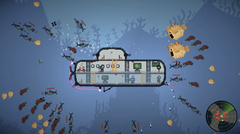

{fig-align="center" width="80%"}

In this co-op deep-sea adventure game, you are part of a team of underwater explorers on a mission to find the treasure! Navigate through treacherous currents, encounter dangerous creatures, and use your teamwork skills to keep your submarine safe and strike gold!

[Download on itch.io (Windows / macOS)](https://amongnight.itch.io/sub-merged-conflicts){.btn .btn-primary .btn-game}

<!--
When this game has a web build, put ONE of these on its own line outside this comment,
with two curly braces instead of three:

Option A, the game is on itch.io as HTML5 (get the number from itch's "Embed game" button):
{}

Option B, a Unity WebGL build in this folder (put Unity's output in games/sub-merged-conflicts/play/):
{}
-->
