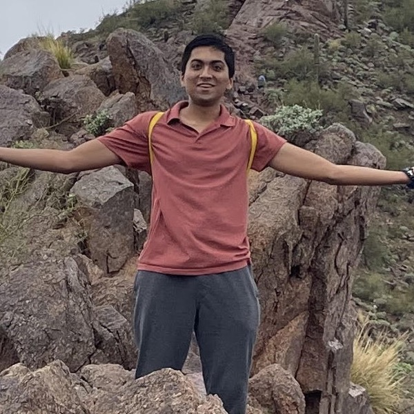

{width=180px style="border-radius:50%; float:right; margin:0 0 1em 1.5em;"}

I'm a software engineer in Boulder, CO. In my free time I make **games** in Unity and build little **side projects**, usually about lakes, water, or making scientific data less annoying to look at.

At my day job at [NCAR](https://ncar.ucar.edu/), I write tools that set up regional ocean simulations in the Community Earth System Model, so scientists spend less time fighting config files. Before that I worked on lake and ice research at the University of Michigan.

- [**Projects**](projects/index.qmd): personal projects, research code, and work software
- [**Games**](games/index.qmd): things I've made in Unity
- [**Blog**](blog/index.qmd): writing

**Find me:**
[GitHub](https://github.com/manishvenu) ·
[itch.io](https://amongnight.itch.io) ·
[LinkedIn](https://www.linkedin.com/in/manish-venumuddula) ·
[Email](mailto:manish.venumuddula@gmail.com)
