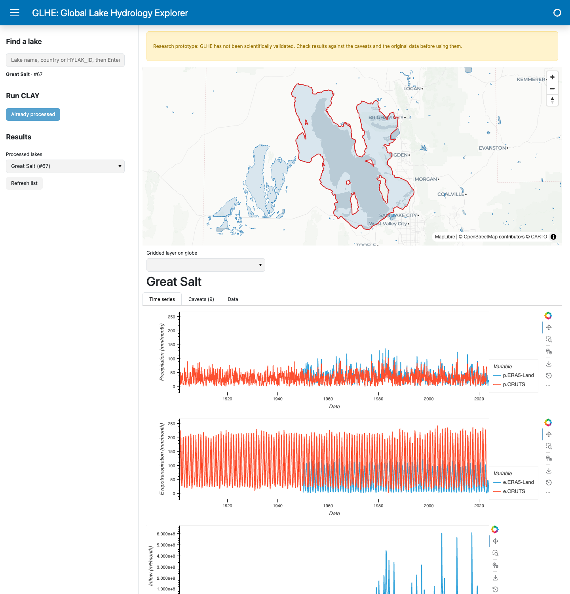

A tool for visualizing lake data worldwide using global precipitation, evaporation, and runoff data. Choose a lake and get a snapshot of its water balance. It's built to be easy to extend, for watershed modeling or water resource management.

[Open the app](https://glhe.venumuddula.com){.btn .btn-primary} [GitHub](https://github.com/manishvenu/Global-Lake-Hydrology-Explorer){.btn .btn-outline-primary}
